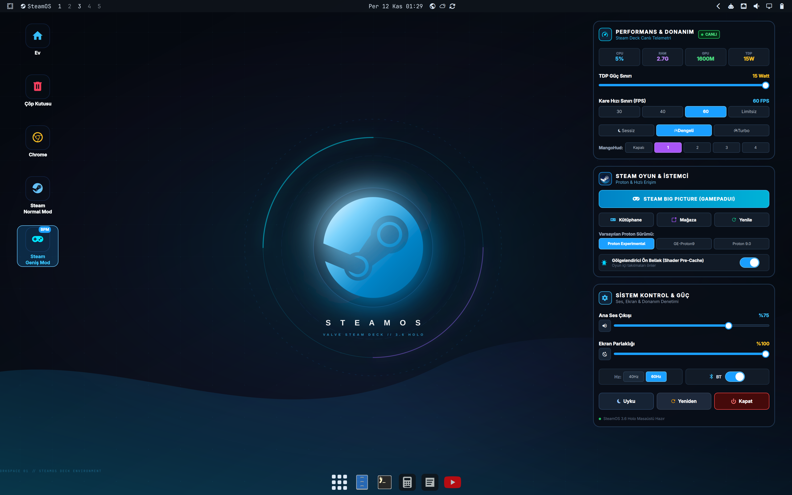
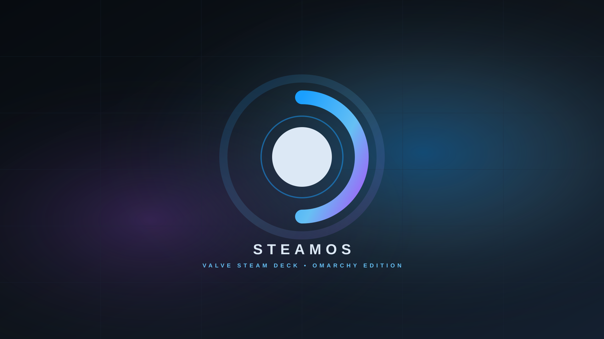
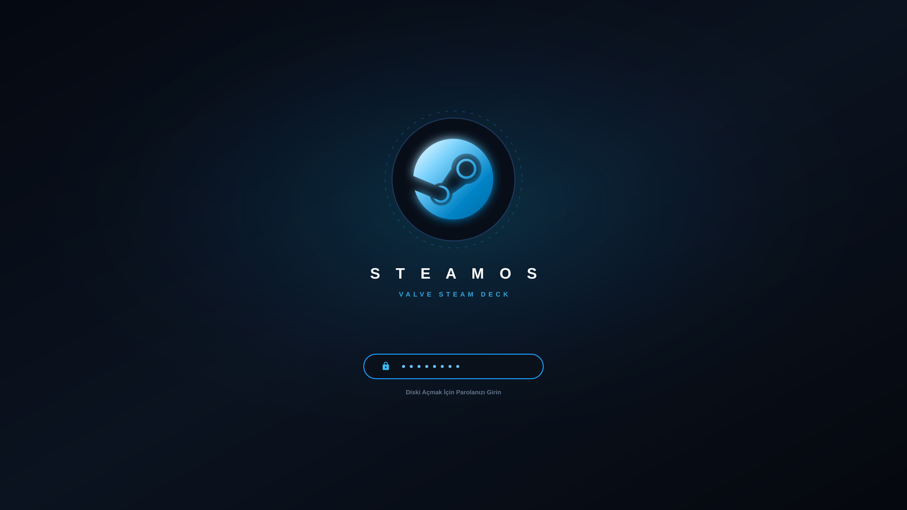

# Omarchy & Arch Linux İçin SteamOS Masaüstü Kiti 🎮 🚀

**Arch Linux** ve **Omarchy** Hyprland Wayland pencere yöneticisi için tasarlanmış, modern ve gerçekçi bir **SteamOS 3.6 Holo** masaüstü ve konsol deneyimi.

Bu proje, **Çalışma Alanı 1**'i (Workspace 1) özel bir Steam Deck masaüstü alanına dönüştürür. Cam efektli (glassmorphic) donanım ve kontrol widget'ları, masaüstü kısayolları, anında Big Picture (GamepadUI) geçişi, sistem geneli SteamOS simgeleri ve başlangıç kilit açma teması sunar. Diğer çalışma alanlarınız ise standart çalışma ve üretkenlik düzeninizi korumaya devam eder.

> 🇬🇧 **For English documentation:** [README.md](README.md)

---

## 📸 Ekran Görüntüleri & Önizleme

### 1. SteamOS Masaüstü Ortamı (Çalışma Alanı 1)


### 2. SteamOS Özel Duvar Kağıdı


### 3. Başlangıç / Disk Kilidi Açma (Plymouth) Ekranı


---

## 🌟 Öne Çıkan Özellikler

### 🖥️ 1. Yalıtılmış SteamOS Masaüstü Alanı
* **Çalışma Alanı İzolasyonu:** Çalışma Alanı 1, 4K ortalanmış Steam Deck duvar kağıdı, masaüstü simgeleri ve sağdaki widget'larla oyun alanına ayrılmıştır.
* **Diğer Alanlara Dokunmama:** 2–10 arasındaki çalışma alanları varsayılan döşeme (tiling), standart temalar ve duvar kağıtlarıyla üretkenliğinizi korur.
* **Kayan Pencere Modu (Floating):** Çalışma Alanı 1 üzerinde açılan uygulamalar, klasik bir masaüstü gibi pencere çubuklarıyla kayar (floating) olarak yerleşir.

### 📊 2. Üç Bağımsız Cam Efektli (Glassmorphic) Widget
Masaüstünün sağına dengeli ve şık bir şekilde yerleştirilmiştir:
1. **Performans & Donanım Monitörü:**
   * Canlı CPU, RAM, GPU ve TDP telemetri kartları.
   * **15W TDP Güç Sınırı** kaydırıcısı.
   * **FPS Sınırlayıcı:** Anında `30 FPS`, `40 FPS`, `60 FPS` ve `Limitsiz` geçişi.
   * **Fan Profili Seçimi:** `Sessiz`, `Dengeli` ve `Turbo`.
   * **MangoHud Katman Düzeyi:** `Kapalı`, `1`, `2`, `3`, `4`.
2. **Steam Oyun & İstemci Merkezi:**
   * Işıltılı **Steam Big Picture (GamepadUI)** başlatıcı butonu.
   * Hızlı **Kütüphane**, **Mağaza** ve **Yenile** erişimleri.
   * **Proton Sürüm Seçici:** `Proton Experimental`, `GE-Proton9`, `Proton 9.0`.
   * **Gölgelendirici Ön Bellek (Shader Pre-Cache)** aç/kapat anahtarı.
3. **Sistem Kontrol & Güç Paneli:**
   * PipeWire ses düzeyi kaydırıcısı + anlık sessize alma.
   * Ekran parlaklığı kaydırıcısı + Gece Işığı anahtarı.
   * Ekran tazeleme hızı geçişi (`40Hz` / `60Hz`).
   * Bluetooth aç/kapat anahtarı.
   * Hızlı güç butonları: **Uyku**, **Yeniden Başlat**, **Kapat**.

### 🕹️ 3. Masaüstü Kısayolları ve Pencere Yönetimi
* **Sol Masaüstü Simgeleri:** Ev Klasörü, Çöp Kutusu, Google Chrome, Steam Normal Mod ve Steam Geniş Mod (BPM).
* **Akıllı Odaklama:** Kısayollara tekrar tıklandığında açık pencere varsa doğrudan ona odaklanır.
* **Otomatik Tam Ekran:** Big Picture açıldığında Çalışma Alanı 1'de otomatik olarak çerçevesiz tam ekrana geçer.

### 🚀 4. Süper + Boşluk SteamOS Menüsü
Omarchy menü sistemine tam entegredir:
* `󰍹 SteamOS Masaüstü Ortamı` &rarr; Çalışma Alanı 1'e geçer.
* `󰓓 Steam (Masaüstü / Normal Mod)` &rarr; Standart Steam istemcisini açar / odaklar.
* `󰊗 Steam Big Picture (GamepadUI)` &rarr; Tam ekran konsol arayüzünü başlatır.
* `󰺵 Oyun Kütüphanesi` &rarr; Doğrudan oyun kütüphanesini açar.
* `󰄗 Steam Mağazası` &rarr; Mağazayı ve indirimleri açar.
* `󰒍 Arkadaşlar & Sohbet` &rarr; Arkadaş listesi ve sohbet penceresini açar.
* `󰒓 Steam İstemci Ayarları` &rarr; Proton, kontrolcü ve istemci ayarlarını açar.

### 🎨 5. Sistem Geneli SteamOS Tasarımı
* **İkon Teması:** SteamOS'in resmi KDE arayüzünde kullandığı `breeze-dark` simge paketi sistem genelinde aktiftir.
* **Hakkında Logosu (Fastfetch):** `fastfetch` ve `omarchy-launch-about` için Valve Steam amblemi ASCII blok sanatı.
* **Plymouth Başlangıç Kilit Ekranı:** Açılış ve disk şifre çözme için SteamOS teması (`preview-unlock.png` & `unlock.png`).

---

## 🚀 Kurulum

### Otomatik Tek Komutla Kurulum

Projeyi klonlayıp kurulum betiğini çalıştırın:

```bash
git clone https://github.com/enisozen/omarchy-steamos-kit.git
cd omarchy-steamos-kit
./kur.sh
```

---

## ⌨️ Önemli Kısayollar

| Kısayol | İşlev |
| :--- | :--- |
| `SUPER + 1` | Çalışma Alanı 1'e Geç (SteamOS Masaüstü) |
| `SUPER + 2..9` | Normal Masaüstlerine Geç (Masaüstü 1..8) |
| `SUPER + SHIFT + S` | Steam Big Picture / Konsol Görünümü Aç/Kapat |
| `SUPER + Boşluk` | Omarchy Menüsünü Aç ("SteamOS" ara) |
| `SUPER + W` | Odaktaki Pencereyi Kapat |
| `SUPER + F` | Tam Ekran Yap / Çık |

---

## 📄 Lisans

Bu proje [MIT Lisansı](LICENSE) ile lisanslanmıştır.  
Valve, Steam ve SteamOS; Valve Corporation'ın tescilli ticari markalarıdır.
