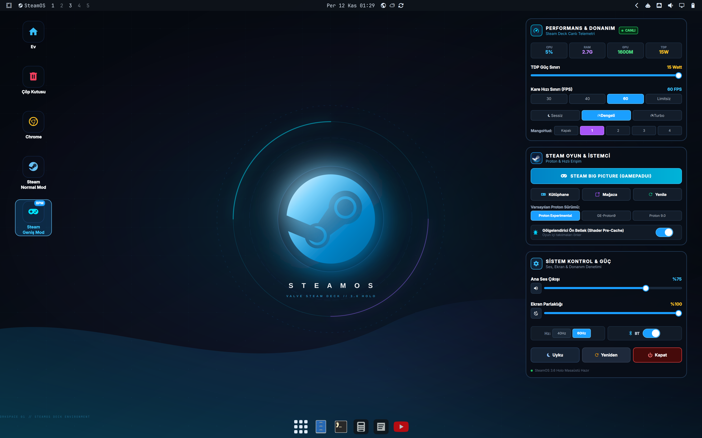
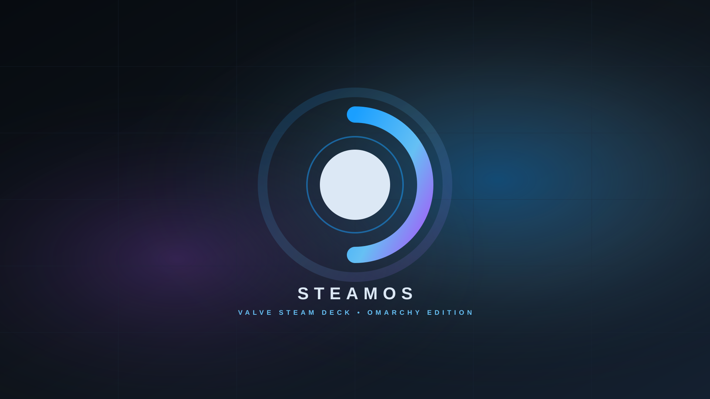
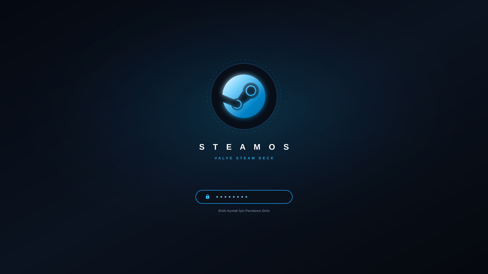

# SteamOS Kit for Omarchy & Arch Linux 🎮 🚀

An authentic, modern **SteamOS 3.6 Holo** desktop and console gaming experience built for **Arch Linux** and the **Omarchy** Hyprland Wayland desktop environment.

It brings a dedicated Steam Deck desktop mode to **Workspace 1**—featuring interactive glassmorphic hardware widgets, classic desktop shortcuts, instant Big Picture (GamepadUI) console integration, system-wide SteamOS icons, and an authentic boot/unlock theme—while keeping all your other workspaces clean for daily productivity.

> 🇹🇷 **Türkçe dokümantasyon için:** [BENIOKU.md](BENIOKU.md)

---

## 📸 Screenshots & Showcase

### 1. SteamOS Desktop Mode (Workspace 1)


### 2. Dedicated SteamOS Wallpaper


### 3. Plymouth Boot & Unlock Screen


---

## 🌟 Key Features

### 🖥️ 1. Isolated SteamOS Desktop (Workspace 1)
* **Single-Workspace Isolation:** Workspace 1 acts as the dedicated SteamOS gaming environment with its 4K centered Steam Deck wallpaper, desktop icons, and glassmorphic widgets.
* **Productivity Preservation:** Workspaces 2–10 remain completely untouched, retaining standard tiling, default themes, and system wallpapers.
* **Smart Floating Mode:** Windows opened on Workspace 1 automatically float with native titlebars and borders, mimicking a classic PC desktop environment without interfering with Hyprland's auto-tiling on other workspaces.

### 📊 2. Three Modular Glassmorphic Desktop Widgets
Positioned seamlessly on the right side of Workspace 1:
1. **Performance & Hardware Monitor:**
   * Live real-time CPU, RAM, GPU, and TDP telemetry badges.
   * Interactive **15W TDP Power Limit** slider.
   * **FPS Limiter Buttons:** Instant switching between `30 FPS`, `40 FPS`, `60 FPS`, and `Unlimited`.
   * **Fan Profile Selector:** `Silent`, `Balanced`, and `Turbo`.
   * **MangoHud Level Picker:** Toggle overlays (`Off`, `1`, `2`, `3`, `4`).
2. **Steam Game & Client Hub:**
   * Glowing hero button: **Steam Big Picture (GamepadUI)**.
   * Quick access buttons for **Library**, **Store**, and **Refresh**.
   * **Proton Version Selector:** `Proton Experimental`, `GE-Proton9`, `Proton 9.0`.
   * **Shader Pre-Caching Toggle:** Enable or disable pre-caching.
3. **System Control & Power Panel:**
   * PipeWire master volume slider + instant mute toggle.
   * Screen brightness slider + Night Light (gece ışığı) toggle.
   * Display refresh rate switcher (`40Hz` / `60Hz`).
   * Bluetooth quick switch.
   * Direct power actions: **Sleep (Uyku)**, **Restart (Yeniden)**, **Shutdown (Kapat)**.

### 🕹️ 3. Authentic Big Picture & Normal Mode Launchers
* **Desktop Icons:** Ev (Home), Çöp Kutusu (Trash), Google Chrome, Steam Normal Mod, and Steam Geniş Mod (BPM).
* **Smart Window Focus:** Re-launching shortcuts intelligently focuses the active Steam window instead of creating duplicate or hung processes.
* **Automatic Fullscreen:** Big Picture / GamepadUI windows automatically go borderless fullscreen on Workspace 1.
* **System Boot Autostart:** Seamlessly launches Steam directly into Big Picture (GamepadUI) mode on Workspace 1 on boot after the desktop environment loads.

### 🚀 4. Integrated Super + Space Launcher Menu
Integrated into Omarchy's menu system (`~/.config/omarchy/extensions/omarchy-menu.jsonc`):
* `󰍹 SteamOS Masaüstü Ortamı` &rarr; Switches to Workspace 1.
* `󰓓 Steam (Masaüstü / Normal Mod)` &rarr; Focuses or launches normal Steam.
* `󰊗 Steam Big Picture (GamepadUI)` &rarr; Enters fullscreen console mode.
* `󰺵 Oyun Kütüphanesi` &rarr; Directly opens the Steam Library.
* `󰄗 Steam Mağazası` &rarr; Directly opens the Steam Store.
* `󰒍 Arkadaşlar & Sohbet` &rarr; Opens online friends and chat.
* `󰒓 Steam İstemci Ayarları` &rarr; Opens client, controller, and Proton settings.

### 🎨 5. System-Wide SteamOS Aesthetic & Top Bar
* **Top Bar SteamOS Launcher:** Status bar begins with a native `󰓓 SteamOS` branding button and launcher menu.
* **Floating App Dock:** Workspace 1 runs in native floating desktop mode with Omarchy's sleek dock (app grid, file manager, terminal, browsers, etc.).
* **Icon Theme:** Uses `breeze-dark` (the official KDE Plasma icon theme of SteamOS) across file managers, file dialogs, and GTK apps.
* **Fastfetch / About ASCII Logo:** Official Valve Steam mechanical linkage emblem ASCII art rendered in `fastfetch` and `omarchy-launch-about`.
* **Plymouth Boot & Unlock Theme:** Authentic SteamOS logo and typography for system boot and disk decryption (`preview-unlock.png` & `unlock.png`).

---

## 🚀 Installation

### Automated One-Command Installation

Clone the repository and run the installer:

```bash
git clone https://github.com/enisozen/omarchy-steamos-kit.git
cd omarchy-steamos-kit
./install.sh
```

*(Or run `./kur.sh` for the Turkish installer).*

---

## ⌨️ Useful Keybindings

| Shortcut | Action |
| :--- | :--- |
| `SUPER + é` (or `SUPER + "`) | Switch to SteamOS Desktop (Workspace 1) |
| `SUPER + 1..9` | Switch to Standard Workspaces (Desktops 1..9) |
| `SUPER + SHIFT + 1..9` | Move window to Desktop 1..9 |
| `SUPER + SHIFT + S` | Toggle Steam Big Picture Mode / Console View |
| `SUPER + Space` | Open Omarchy Menu (Search "SteamOS") |
| `SUPER + W` | Close focused window |
| `SUPER + F` | Toggle window fullscreen |

---

## 📄 License

This project is licensed under the [MIT License](LICENSE).
Valve, Steam, and SteamOS are trademarks and/or registered trademarks of Valve Corporation.
